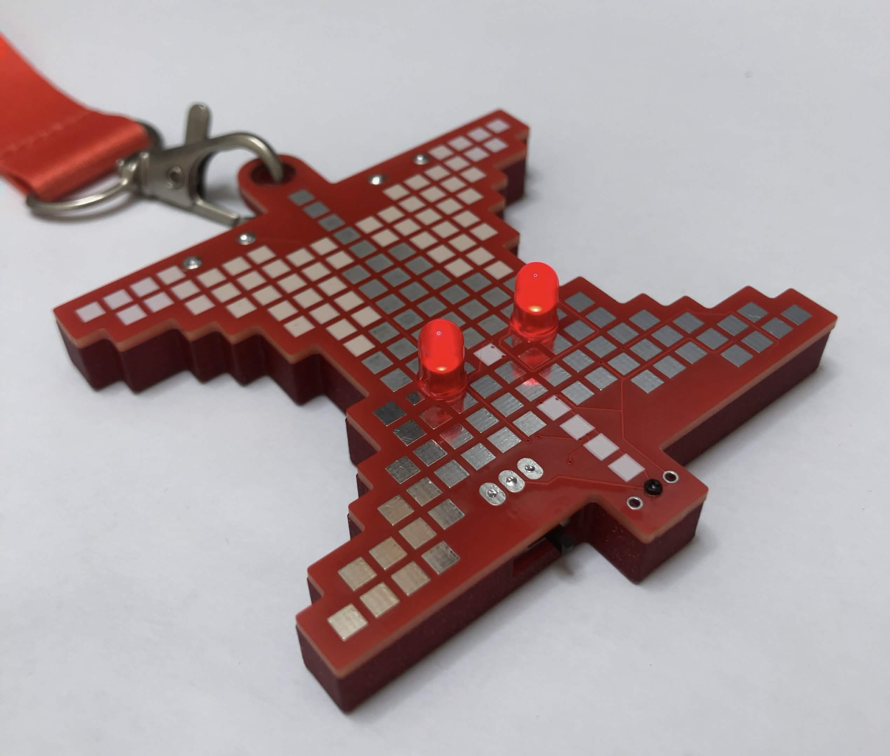

# 裏蓋・ケース

[English](README_EN.md) · [プロジェクト概要](../README.md)

- 3Dプリント用データ：[case.stl](case.stl)
- 固定方法：**M1 × 3mmのねじで下側を留めます。**

ねじの本数・頭の形状・ねじの種類、材料や印刷設定は未記載です。組み付け時は、電池交換とスイッチ操作ができることを確認してください。

作者の同意により、STLは基板と同じ[CERN-OHL-P-2.0](../LICENSES/CERN-OHL-P-2.0.txt)で公開しています。ライセンスの条件に従って製作・改造・再配布・販売できます。説明書はCC BY 4.0です。
