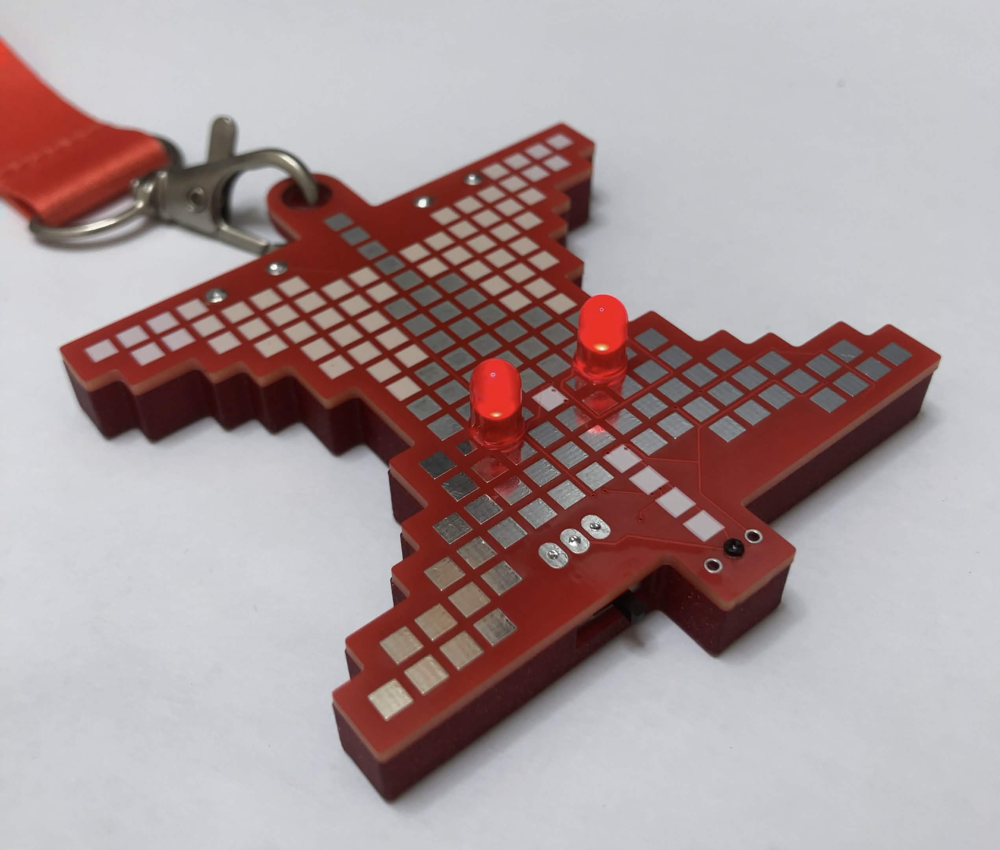

# Rear cover / case

[日本語](README.md) · [Project overview](../README_EN.md)

- 3D-printing file: [case.stl](case.stl)
- Fastening: **secure the lower part with an M1 × 3mm screw.**

Screw quantity, head style, and thread type, as well as material and print settings, have not yet been specified. Check that the assembled cover allows battery replacement and access to the switch.

With its author’s agreement, the STL is licensed under [CERN-OHL-P-2.0](../LICENSES/CERN-OHL-P-2.0.txt), the same license as the board. Manufacturing, modification, redistribution, and sales are allowed under its terms. The documentation is CC BY 4.0.
