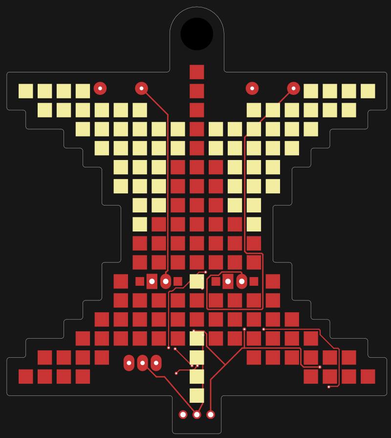
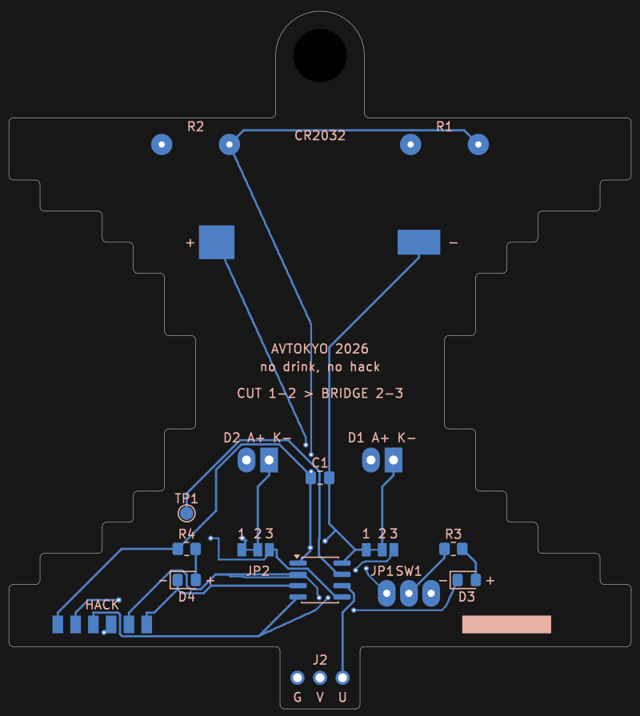
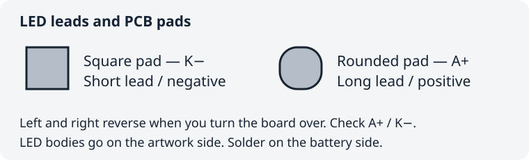

# Basic assembly — AVTOKYO LED Charm

This guide shows **one of the simplest configurations**: two red LEDs with resistors. You are free to change or add components and experiment with MCU control. Check component ratings, polarity, and resistor values when making changes. See [licensing and modifications](LICENSE_EN.md).

[日本語](ASSEMBLY_JA.md)

Build a charm with two red LEDs controlled by a power switch.

**Leave JP1 and JP2 as supplied. Basic assembly requires no cutting or extra solder on these jumpers.**

## 1. Gather the parts and tools

| Part | Quantity | Board marking |
|---|---:|---|
| 1kΩ resistor (1,000Ω) | 2 | R1, R2 |
| 5mm red LED | 2 | D1, D2 |
| CH7410-2032LF battery holder | 1 | Battery position near the top |
| SS-12D01G3 slide switch | 1 | SW1 |
| CR2032 battery | 1 | Insert after soldering |

Prepare a soldering iron and stand, electronics solder, flush cutters, tweezers, and a board holder. Flux is helpful for the battery holder.

**Remove the battery and disconnect any programmer before soldering.** Keep clear of the hot iron tip and work with ventilation. Hold clipped leads so they do not fly away. Keep coin cells out of reach of small children.

## 2. Identify the front and back

- The **front** has the pixel artwork and the two eye LEDs. The resistor bodies also sit on this side.
- The **back** holds the battery holder and switch. R1 and R2 are labeled on the back.

These CAD views show component locations. Red and blue lines highlight copper traces. The finished board has black solder mask, white printing, and silver exposed metal.

| Front | Back |
|---|---|
|  |  |

## 3. Fit the two resistors

1. Find the two pairs of holes near the top, corresponding to R1 and R2 on the back.
2. Bend the leads to fit the holes, which are 7.62mm apart center to center. Avoid bending tightly against the resistor body.
3. Insert the leads **from the front**, with the resistor body on the front. Resistors can go either way around.
4. Turn the board over. Heat the lead and its metal pad together, then feed in solder.
5. Let the joint cool and trim the excess lead.

A pad is the metal area around a hole. Solder should wet both the lead and the pad.

## 4. Fit the two LEDs

**LED polarity matters. Check the leads before trimming them.**

| LED lead | Board marking |
|---|---|
| Long lead, positive (anode) | A+, rounded pad |
| Short lead, negative (cathode) | K−, square pad |

1. Insert D1 and D2 **from the front**.
2. Check that each long lead goes to A+ and each short lead goes to K−.
3. Solder one lead on the back, check the LED alignment, then solder the other lead.
4. Trim the excess leads.

If the leads have already been trimmed, check polarity using the component documentation or a multimeter.

## 5. Fit the switch

1. Insert the SS-12D01G3 into the three SW1 holes **from the back**.
2. Point the switch actuator outward beyond the bottom edge of the board.
3. **Solder all three leads on the front.** Check that adjacent pads are not joined by solder.

## 6. Fit the battery holder

1. Place the empty CH7410-2032LF on the battery footprint near the top of the back.
2. Match the holder's positive terminal to the board's + and its negative terminal to the board's −. Check the terminal positions before fixing it in place.
3. Align the terminals over their pads and tack one terminal with a small amount of solder.
4. Check alignment, solder the other terminal, then finish the first joint.

Secure the board and heat the exposed metal terminal and pad together from the outside. Avoid prolonged contact between the iron and the plastic body.

## 7. Insert the battery and switch on

Before inserting the battery, check that

- Both resistors and both LEDs are fitted.
- Each LED's long lead is at A+ and its short lead is at K−.
- All required joints are soldered, with no accidental bridges between adjacent terminals.
- Clipped leads and metal debris have been removed.

Set the switch to OFF. Insert the CR2032 according to the holder markings, with the battery's + face against the positive contact. Switch on. Both eyes should light up.

Switch off when not in use. Remove the battery for long-term storage.

## If the LEDs do not light

| Symptom | What to check |
|---|---|
| Both LEDs are off | Both switch positions, battery orientation and charge, holder and switch joints |
| One LED is off | That LED's polarity and the joints on its LED and resistor |
| Light changes when touched | Battery contacts and loose solder joints |
| Battery or parts become hot | Remove the battery immediately and check for solder shorts and reversed battery polarity |

Remove the battery before reworking solder joints. If the JP1 or JP2 connection between pads 1 and 2 has been cut, restore the 1–2 connection and leave 2–3 open for basic constant illumination.

## Further modifications

U1, C1, D3, D4, the HACK port, and the G/V/U connector support additional experiments. After checking basic operation, see the [MCU modification guide](HACK_EN.md) and [programming instructions](../firmware/README_EN.md).

This guide uses the specified red LEDs with 1kΩ resistors. For two-lead automatic color-changing RGB LEDs, select resistors suitable for the actual LEDs and check that both LEDs complete their color cycles together on a CR2032.

## Optional rear cover

Print [case.stl](../case/case.stl) and secure the lower part with an **M1 × 3mm screw**. See the [case instructions](../case/README_EN.md).
