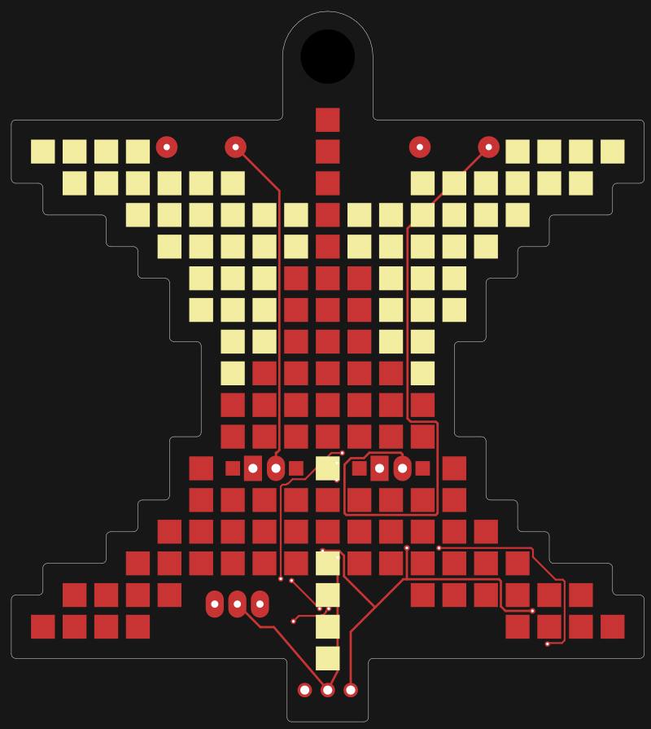
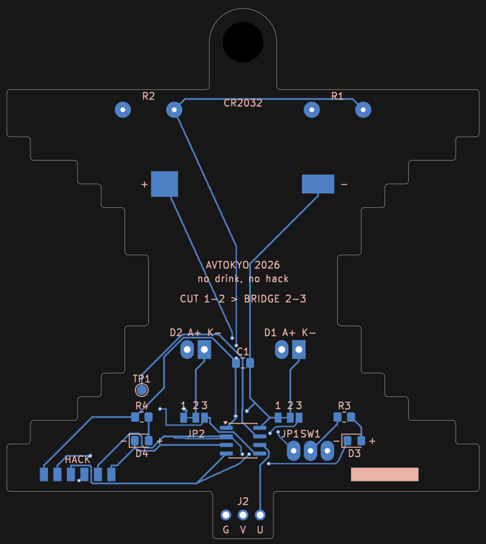
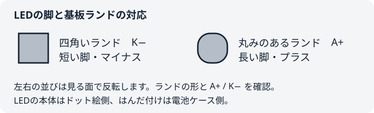

# 基本の作り方 — AVTOKYO LED Charm Rev M

[English](ASSEMBLY_EN.md)

赤いLEDを2個付けて、電源スイッチで点灯するチャームを作ります。

**JP1・JP2は、そのままで使います。基本の組み立てではカットや追加のはんだ付けは不要です。**

## 1. 部品と道具をそろえる

| 部品 | 数 | 基板の目印 |
|---|---:|---|
| 1kΩ抵抗（1,000Ω） | 2本 | R1・R2 |
| 5mm赤色LED | 2個 | D1・D2 |
| 電池ホルダー CH7410-2032LF | 1個 | 上部の電池取付位置 |
| スイッチ SS-12D01G3 | 1個 | SW1 |
| CR2032電池 | 1個 | 最後に入れる |

はんだごて、こて台、電子工作用はんだ、ニッパー、ピンセット、基板を支える台を用意します。電池ホルダーの作業にはフラックスがあると便利です。

**作業中は電池と書き込み器を外します。** こて先には触れず、換気しながら作業してください。脚を切るときは切れ端が飛ばないよう押さえます。コイン電池は小さな子どもの手の届かない場所に置きます。

## 2. 表と裏を確認する

- **表面**はドット絵と目のLEDがある側です。抵抗も表面に載せます。
- **裏面**は電池ホルダーとスイッチがある側です。R1・R2の番号は裏面にあります。

以下は配置を確認するCAD図です。赤・青の線は配線を見やすく表示した色です。完成基板は黒い基板に白印刷と銀色の金属面になります。

| 表面 | 裏面 |
|---|---|
|  |  |

## 3. 抵抗を2本付ける

1. 裏面のR1・R2に対応する、上部の2組の穴を探します。
2. 抵抗の脚を穴の間隔に合わせて曲げます。穴の中心間隔は7.62mmです。本体の根元を無理に曲げないようにします。
3. **表面から**脚を通し、抵抗本体を表面に置きます。抵抗はどちら向きでも使えます。
4. 裏返して、脚と周囲の金属ランドを一緒に温め、はんだを流します。
5. はんだが固まってから余った脚を切ります。

ランドは、穴の周囲にあるはんだ付け用の金属部分です。はんだは脚とランドの両方に広がるように付けます。

## 4. LEDを2個付ける

**LEDには向きがあります。脚を切る前に確認してください。**

| LEDの脚 | 基板側の目印 |
|---|---|
| 長い脚・＋（アノード） | A+、丸みのあるランド |
| 短い脚・−（カソード） | K−、四角いランド |

1. D1・D2に、**表面から**LEDを挿します。
2. 長い脚がA+、短い脚がK−に入っていることを両方とも確認します。
3. 裏面で片方の脚をはんだ付けし、LEDの傾きを確認してからもう片方を付けます。
4. 余った脚を切ります。

すでに脚が切ってあるLEDは、部品の仕様やテスターで極性を確認してください。

## 5. スイッチを付ける

1. SS-12D01G3を、裏面のSW1の3穴へ**裏面から**挿します。
2. 操作用のつまみが基板の下の外側へ向くように置きます。
3. **表面で3本の脚をはんだ付け**します。隣同士のランドがはんだでつながっていないか確認します。

## 6. 電池ホルダーを付ける

1. 電池を入れずにCH7410-2032LFを裏面上部へ置きます。
2. ホルダーの＋端子と基板の＋、−端子と基板の−を合わせます。ホルダーの端子位置と基板の表示を確認してから固定します。
3. 端子とランドが重なる位置で、一方を少量のはんだで仮止めします。
4. 位置を確認してからもう一方を付け、最初の端子も確実にはんだ付けします。

端子の外側から、金属端子とランドを一緒に温めます。基板を固定して、露出している端子へこて先を当てます。樹脂にこて先を当て続けないようにします。

## 7. 電池を入れて点灯する

電池を入れる前に、次の4つを確認します。

- 抵抗2本とLED2個が付いている。
- LEDの長い脚がA+、短い脚がK−に入っている。
- はんだの付け忘れや、隣の端子同士のはんだのつながりがない。
- 基板上に切った脚や金属くずが残っていない。

スイッチをOFF側にし、ホルダーの表示に合わせてCR2032を入れます。＋表示のある面が＋接点側です。スイッチを切り替え、両目が光れば完成です。

使わないときはスイッチをOFFにします。長く保管するときは電池を外します。

## 光らないとき

| 症状 | 確認するところ |
|---|---|
| 両方とも光らない | スイッチの両位置、電池の向きと残量、ホルダーとスイッチのはんだ |
| 片目だけ光らない | そのLEDの極性、LEDと抵抗のはんだ |
| 触ると点いたり消えたりする | 電池接点、ホルダーや部品のはんだ付け |
| 電池や部品が熱くなる | すぐ電池を外し、端子間のはんだ短絡と電池の向きを確認 |

はんだを直す前に電池を外します。JP1・JP2の1–2間をカットしている場合、基本の常時点灯には1–2間を接続し、2–3間を開放した状態に戻します。

## もっと改造したい方へ

U1・C1、D3・D4、HACKポート、GVU端子は追加工作用です。基本の点灯を確認したあと、[改造ガイド](HACK_JA.md)へ進んでください。

この説明は指定の赤色LEDと1kΩ抵抗を使う構成です。自動で色が変わる2本足RGB LEDを使う場合は、使用するLEDに合った抵抗を選び、CR2032で2個同時に色が一巡することを確認してください。
