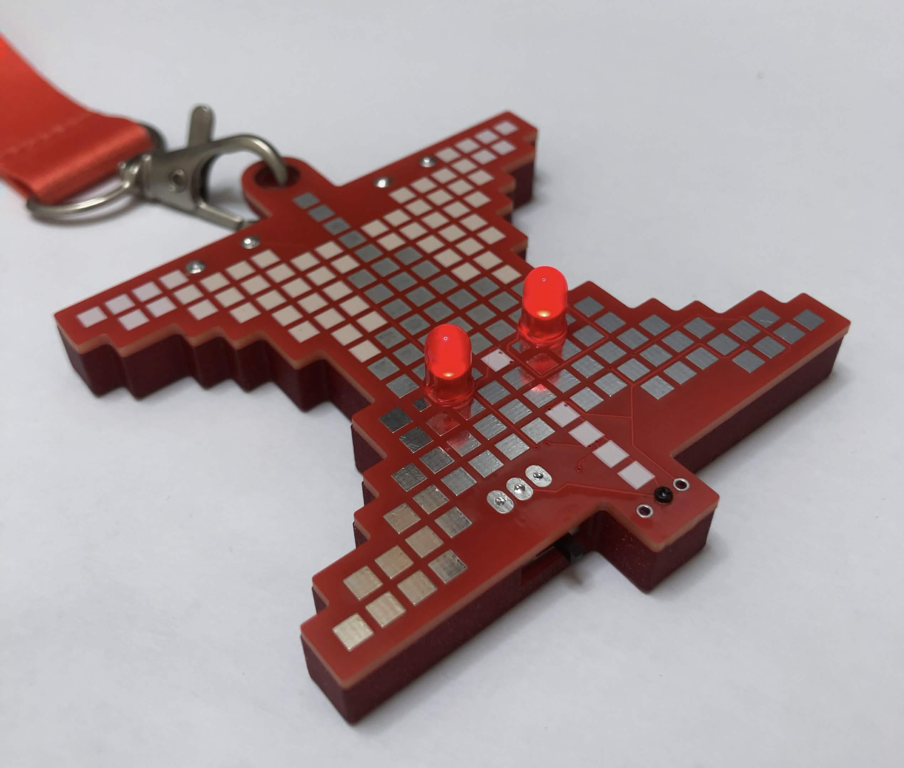

# Parts list — Rev M

[日本語](PARTS_JA.md) · [Project overview](../README_EN.md)

## Basic assembly: one board

| Reference | Part | Quantity | Reference link |
|---|---|---:|---|
| R1, R2 | Small metal film resistor, 1kΩ, 1/4W, MFS25F1KB | 2 | [Akizuki 108535](https://akizukidenshi.com/catalog/g/g108535/) |
| D1, D2 | 5mm low-current red LED, OSR5PA5A33A-1MA | 2 | [Akizuki 116914](https://akizukidenshi.com/catalog/g/g116914/) |
| BT1 | CR2032 holder, CH7410-2032LF | 1 | [Akizuki 102684](https://akizukidenshi.com/catalog/g/g102684/) |
| SW1 | Slide switch, SS-12D01G3 | 1 | [Akizuki 115704](https://akizukidenshi.com/catalog/g/g115704/) |
| Battery | CR2032, 3V, non-rechargeable | 1 | Commonly available |

The resistor holes are 7.62mm apart center to center. Use small resistors whose bodies fit this spacing. If substituting a CH28 holder or SS12D01G4 switch, check terminal locations and board compatibility separately.

## MCU and optional modifications

| Reference | Part | Quantity |
|---|---|---:|
| U1 | ATTINY402-SSNR, SOIC-8 | 1 |
| C1 | 0.22µF, 16V ceramic capacitor, metric 2012 (0805) | 1 |
| J2 | Optional 3-pin header, 2.54mm pitch | 1 |
| D3, D4 | Low-forward-voltage LEDs, metric 2012 (0805) | Up to 2 |
| R3, R4 | Resistors, metric 2012 (0805); start with 1kΩ for low-current red LEDs and verify operation | Up to 2 |
| Shared equipment | ATtiny402-compatible UPDI programmer with 3.3V target power and signals | 1 |

Pair D3 with R3 and D4 with R4, and control the corresponding GPIO pins in your firmware.

Supplier links identify the parts. Check stock and pricing with the supplier.

## Optional rear cover

| Item | Part |
|---|---|
| Rear cover | [STL file](../case/case.stl) |
| Fastening screw | M1 × 3mm; secures the lower part of the cover |

See the [case instructions](../case/README_EN.md). Screw quantity, head style, and thread type are not yet specified.
